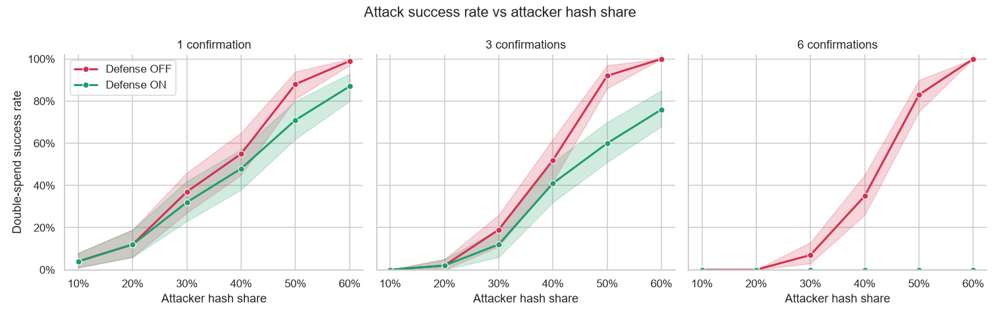
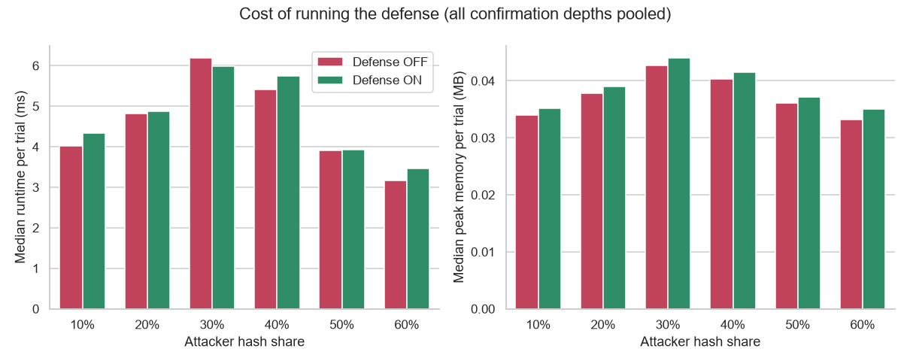

# pow-51-sim

A simulation of a **51% double-spend attack** on a proof-of-work blockchain, and of a
defense against it. An attacker pays a victim, secretly mines a competing chain that
spends the same coin back to itself, and releases it once it is longer. The project
measures how often that works, what the defense stops, and what it costs.

> Educational simulation. It models consensus rules, not a real network or real hashing.

## 1. Setup

Requires **Python 3.10+**.

```bash
python -m venv .venv
source .venv/bin/activate          # Windows: .venv\Scripts\activate
pip install -r requirements.txt
pip install -e ".[dev,notebook]"   # re-run after pulling so new packages are installed
```

Optional: `git init` (if this folder is not already its own repo), then
`pre-commit install` to run **ruff, black and mypy** on every commit.

## 2. Quick run

```bash
pytest                                        # tests, 80% coverage gate with --cov
python -m src.simulation.runner               # grid -> results/results.csv
streamlit run src/dashboard/app.py            # interactive dashboard
jupyter notebook notebooks/analysis.ipynb     # charts and conclusions
```

## 3. Architecture

Each layer only imports the ones below it.

```
 notebooks/analysis.ipynb      src/dashboard (Streamlit + Plotly)
            \                     /
             src/simulation/   runner, attack scenario, plots, false positives
                      |
              src/defense/     UTXOSet, ChainComparator, LongPrivateChainRule
                      |
              src/miners/      HonestMiner, MaliciousMiner, Network (event queue)
                      |
               src/core/       Transaction, Block, Blockchain, ConsensusRule, pow
```

**How one attack trial flows:**

```
 Network clock: next block ~ Exp(600 s), finder picked by hash share
        |
        +-- HonestMiner     --> broadcast --> delay --> every node (own chain view)
        |
        '-- MaliciousMiner  --> private chain (withheld, spends the coin to itself)
                |
   release when: payment has N confirmations AND private chain is longer
                |
   honest nodes apply longest-chain + LongPrivateChainRule
                |
   AttackResult: success, reorg depth, private length, orphan rate, ...
```

**The defense.** `LongPrivateChainRule` flags a block that makes 6 in a row from one
miner. **Safe Mode** then runs `ChainComparator` against the current main chain: the
block is rejected only if its chain spends the same output as the main chain does in a
different transaction (fraud). Otherwise it is accepted and logged as a false
positive, so honest large miners are never blocked blindly.

**Key pieces**

1. **Blockchain**: a block tree with longest-chain fork choice (first seen wins ties),
   injected `ConsensusRule`s, and `on_reorg` / `on_extend` hooks.
2. **UTXOSet**: tracks unspent outputs and rolls back on reorgs through those hooks.
3. **Network**: seeded discrete-event simulation with exponential block times.
4. **SimulationRunner**: runs seeded trials over shares, confirmation depths and
   defense on/off; trial seeds are shared by both modes so they are paired.

`src/pow51sim/` is an earlier, self-contained iteration of the same idea. The pipeline
above does not use it; it is kept for reference and still has its own tests.

## 4. Running things

**Tests**

```bash
pytest                      # everything
pytest tests/core tests/miners tests/defense tests/simulation
pytest -m integration       # end-to-end runs only
pytest --cov                # coverage, fails below 80%
ruff check . && black --check . && mypy src
```

**Simulation grid to CSV**

```bash
python -m src.simulation.runner --trials 100 --seed 42 --out results/results.csv
```

Columns: `scenario, attacker_share, confirmation_depth, attack_success,
blocked_by_safe_mode, private_len, final_chain_length, reorg_depth,
max_consecutive_by_one_miner, orphan_rate, runtime_ms, memory_mb`. `scenario` is
`Defense OFF` or `Defense ON`. Add `--detailed` for block-ownership columns and
`--no-memory` to skip memory tracing. `python -m simulation.runner` works too.

**From Python**

```python
from simulation.attack import make_scenario

result = make_scenario(attacker_share=0.5, confirmation_depth=3,
                       defense_enabled=True, seed=1).run()
print(result.attack_success, result.reorg_depth, result.blocked_by_safe_mode)
```

**Dashboard.** `streamlit run src/dashboard/app.py` has a sidebar for the share range,
trials per point, confirmation depth, LPC limit, seed and focus share; four KPI cards;
and tabs for Success Rate, Chain Race (replay one attack by seed), False Positives and
Raw Data (CSV download). The grid runs on the real simulator (about 12 s for the default
view, then cached). The single-race replay and the false-positive curve use a fast
model in `src/dashboard/model.py`.

**Notebook.** `notebooks/analysis.ipynb` loads (or generates) the CSVs, draws the four
charts below and states a conclusion under each. `python scripts/generate_figures.py`
rewrites the README images.

## 5. Sample results

Default run: seed 42, 100 trials per cell, 5 honest miners, LPC limit 6.

**Attack success vs attacker hash share**



1. At 3 confirmations and 50% share, success drops from **92% to 60%** with the defense.
2. At 6 confirmations the defense stops every attack (**83% to 0%** at 50% share).
3. With 1 or 3 confirmations the attacker overtakes within about 5 blocks, before the
   6-block rule can fire, so the gain is moderate.

**Final chain structure**


1. Successful attacks orphan honest blocks (about 35-38% at 50-60% share).
2. A 50% attacker owns about 88% of the final chain without the defense, 44% with it.

**Cost of the defense**



1. Median runtime rises about **6%** and peak memory about **3%**.
2. Trials take milliseconds, so read these as order of magnitude.

**False positives**


1. Honest miners with 30-45% share are flagged in **7% to 56%** of 144-block runs.
2. Flagged honest blocks are accepted (no conflicting spend), so the cost is an extra
   check, not lost rewards.

## 6. Limitations

1. **Simplified PoW**: blocks are found probabilistically (win chance equals hash
   share). The hash loop in `core.pow` is for tests only.
2. **Simplified network**: a fixed-delay broadcast with no relaying, peer topology or
   real latency, and **no difficulty adjustment**.
3. **Simplified chain data**: transactions have no signatures, fees or mempool rules,
   and honest miners behave ideally.
4. **One attack shape**: one attacker, one payment, a fork taken right before it, and
   release as soon as the private chain is longer and the payment is confirmed.
5. **Honest large miners are flagged**: miners with 40% or more can legitimately mine
   6 blocks in a row. Safe Mode avoids rejecting them, but they are still logged.
6. **Sybil bypass (future work)**: an attacker who splits its hash power across several
   identities never produces 6 consecutive blocks from one miner, so this rule does not
   see it.
7. **Late detection**: a private chain that overtakes within 5 blocks completes before
   the rule triggers, so shallow confirmation depths are only partly protected.
8. **Metrics**: orphan rate counts only published blocks, and runtime and memory are
   micro-benchmarks that vary between machines.
