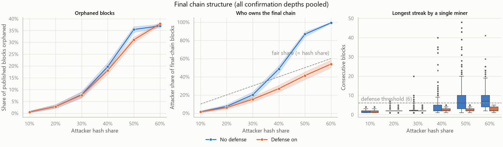
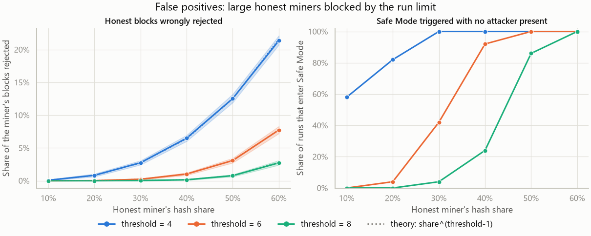

# pow-51-sim

A simulation of a **51% double-spend attack** on a proof-of-work blockchain, and of a
defense against it. An attacker pays a victim, secretly mines a competing chain that
spends the same coin back to itself, and releases it once it is longer. The project
measures how often that works, and what the defense costs.

> Educational simulation. It models consensus rules, not a real network or real hashing.

## 1. Setup

Requires **Python 3.10+**.

```bash
python -m venv .venv
source .venv/bin/activate          # Windows: .venv\Scripts\activate
pip install -r requirements.txt
pip install -e ".[dev]"            # add ",notebook" to run the Jupyter notebooks
pytest --cov                       # 80% coverage gate
```

Optional: `git init` (if this folder is not already its own repo), then
`pre-commit install` to run **ruff, black and mypy** on every commit.

## 2. Architecture

Lower layers never import the layers above them.

```
 notebooks/, scripts/        analysis only, no logic
        |
   analysis/    tables, plots (seaborn/matplotlib), closed-form references
        |
  simulation/   AttackScenario, SimulationRunner, Network, FalsePositiveExperiment
        |
    miners/     HonestMiner, MaliciousMiner, BlockReceiver
        |
   defense/     LongPrivateChainRule, MaxReorgDepthRule, ChainComparator
        |
     core/      Block, Transaction, Blockchain, UTXOSet, ConsensusRule + rules
```

**One attack trial:**

```
 AttackConfig + rules + seeded RNG
              |
        AttackScenario
         /           \
 HonestMiner x N     MaliciousMiner
  extends the         mines a private fork
  public chain        (withheld, includes the refund tx)
         \           /
   release when: payment has N confirmations
                 AND private chain is longer
              |
        AttackResult
  success, reorg_depth, orphans, longest streak ...
```

**Key components**

1. **Blockchain**: a block tree with longest-chain fork choice. Validation is pluggable
   through `ConsensusRule`, so new rules need no engine changes.
2. **UTXOSet**: follows the main chain and rolls back on reorgs.
3. **LongPrivateChainRule**: rejects a block that makes `max_consecutive` (default 6)
   blocks in a row from one miner. The first rejection switches that chain into
   **Safe Mode**, where every reorg is checked by the `ChainComparator` and rejected
   if it re-spends coins differently from the main chain.
4. **MaxReorgDepthRule**: rejects reorgs deeper than a limit.
5. **Network**: discrete-event simulation with exponential block arrivals, random
   propagation delay and a seed for reproducibility.

## 3. Running the scenarios

All examples are seeded, so reruns give identical results.

**A. Single double-spend race** (round-based, defense off vs on)

```python
from random import Random

from pow51sim.defense.rules import build_rules
from pow51sim.simulation.config import AttackConfig
from pow51sim.simulation.scenario import AttackScenario

config = AttackConfig(attacker_share=0.45, confirmations=3, honest_miners=10)
for label, limit in (("no defense", None), ("defense on", 6)):
    rules = build_rules(max_reorg_depth=None, max_consecutive=limit)
    wins = sum(AttackScenario(config, rules, Random(s)).run().success for s in range(200))
    print(f"{label}: {wins / 200:.0%} success")   # 66% vs 38%
```

**B. Parameter grid to CSV** (shares 10-60%, confirmations, defense on/off)

```python
from pow51sim.simulation.simulation_runner import ParameterGrid, SimulationRunner

runner = SimulationRunner(trials=200, seed=42, grid=ParameterGrid(), detailed=True)
frame = runner.run_to_csv("results/grid_detailed.csv")
```

Columns: `scenario, attacker_share, attack_success, final_chain_length, reorg_depth,
max_consecutive_by_one_miner, runtime_ms, memory_mb`. `detailed=True` appends orphan
and block-ownership counts. The `scenario` label holds the confirmation depth and
defense setting, e.g. `conf=3,defense=on`.

**C. Discrete-event network** (latency, propagation, withheld fork)

```python
from pow51sim.defense.rules import build_rules
from pow51sim.simulation.builders import build_network

net = build_network(
    malicious_share=0.45, honest_count=10, block_interval=600, mean_latency=2,
    confirmations=3, seed=1, rules=build_rules(None, max_consecutive=6),
)
net.run(until=600 * 300)
net.drain()                          # stop mining, deliver blocks still in flight
print(len(net.block_log), net.miners[0].released)
```

**D. False positives** (honest-only network, large miner vs the run limit)

```python
from pow51sim.simulation.false_positives import FalsePositiveExperiment

FalsePositiveExperiment(trials=50, seed=42).run_to_csv("results/false_positives.csv")
```

**E. Notebook and figures**

```bash
jupyter lab notebooks/defense_evaluation.ipynb   # generates the CSVs on first run
python scripts/generate_figures.py               # rewrites docs/images/*.png
```

`notebooks/attack_analysis.ipynb` shows the aggregated `sweep()` API and compares it
with the closed-form Nakamoto probability.

## 4. Sample results

200 trials per grid cell, seed 42, 10 honest miners, defense threshold 6.

**Attack success vs attacker hash share**


1. At 3 confirmations and 50% share, success drops from **86% to 54%** with the defense.
2. At 6 confirmations the defense stops the attack at every share (**83% to 0%** at 50%).
3. Below 30% share the attack rarely works, with or without the defense.

**Final chain structure**



1. A successful attack orphans honest blocks; orphan rate climbs past 35% at 50-60% share.
2. Without the defense a 50% attacker owns far more than its fair share of the final
   chain; with it, **no miner exceeds 5 consecutive blocks** (48 without it).

**Cost of the defense**


1. Median runtime overhead is about **15-42%** and memory about **4-6%**.
2. Trials are sub-millisecond, so read these as order of magnitude, not precise.

**False positives**



1. A lone honest miner has `share^(threshold-1)` of its blocks rejected (dotted line,
   matches the simulation).
2. At threshold 6, a 60% honest miner loses **7.7%** of its blocks; a 30% miner, 0.2%.
3. Honest-only runs can enter Safe Mode with no attacker present.

## 5. Tests, lint and CI

1. `pytest --cov` runs unit and end-to-end tests (`pytest -m integration` for the
   end-to-end ones only).
2. `ruff check . && black --check . && mypy src` runs the static checks.
3. **GitHub Actions** (`.github/workflows/ci.yml`) runs the same checks on Python
   3.10-3.12 and fails below 80% coverage.
4. `.pre-commit-config.yaml` runs the file hygiene hooks, ruff, black and mypy.

## 6. Limitations

1. **Simplified attack model**: one attacker, one payment, and a fork taken right
   before the payment. The round-based scenario has no network delay; the `Network`
   scenario has delay but no payment or merchant logic.
2. **No real mining**: blocks are found probabilistically. There is no difficulty
   adjustment, and selfish mining is not modeled.
3. **Simplified chain data**: UTXO transactions have no signatures, fees or mempool,
   and honest miners behave ideally.
4. **Defense trade-offs**:
   - Large honest miners are rejected at a measurable rate.
   - A fork released in pieces can still win with 5 or fewer blocks.
   - Safe Mode never switches off.
   - Each node decides alone; rejections are not shared.
5. **Results vs theory**: simulated success sits below the Nakamoto closed form,
   partly because the attacker gives up after falling 10 blocks behind (or after 500 rounds).
6. **Metrics**: the orphan rate counts only published blocks, and runtime and memory
   are micro-benchmarks that vary between machines.
